# VITA 49 Signal Processor & Real-Time Web Simulator

A high-performance SDR digital signal processing application with standard **ANSI/VITA 49.0 / VITA 49.2 (VRT - VITA Radio Transport)** ingestion, DSP spectral estimation, interactive real-time visualizers, and a web-based signal simulator.

---

## System Overview

```mermaid
flowchart TD
    subgraph Simulator ["Web Signal Simulator"]
        UI_Sim["Web Simulator Controls\n(Presets, Frequency, Bandwidth, Mod, Power, Noise)"]
        Gen["Synthetic RF Signal Engine\n(CW, Chirp FMCW, BPSK, QPSK, Pulses, AWGN)"]
        Enc["VITA 49 Encoder\n(Data & CIF0 Context Packets)"]
        UI_Sim --> Gen --> Enc
    end

    subgraph Network ["Network Transport Layer"]
        UDP["UDP Ingestion Socket (127.0.0.1:4991)\nStandard SDR VITA-49 Datagrams"]
        Enc --> UDP
    end

    subgraph Backend ["Python DSP Backend (FastAPI + NumPy + SciPy)"]
        UDP_Rx["Async UDP Receiver Daemon"]
        Decoder["VITA 49 Parser / Decoder\n(Header, CIF0, TSI/TSF Timestamps, I/Q Payload, Trailer)"]
        DSP["DSP Signal Analyzer\n- Windowed FFT & Power Spectral Density (dBFS)\n- Peak & Center Frequency Detection\n- Occupied Bandwidth (99% OBW) & -3dB Span\n- Noise Floor & SNR (dB)\n- Burst Start / Stop Time Energy Detector\n- Modulation Classifier"]
        Hub["WebSocket Broadcast Hub (30 FPS)"]

        UDP --> UDP_Rx --> Decoder --> DSP --> Hub
    end

    subgraph Frontend ["Web Instrument Dashboard (React + Vite + Tailwind)"]
        HUD["Signal Metrics HUD\n(Freq, Bandwidth, SNR, Power, Burst Timing)"]
        Spectrum["Interactive Spectrum Analyzer (Canvas FFT)\n(Peak Marker, -3dB & OBW Span, Max-Hold, Cursor Tooltip)"]
        Waterfall["High-Speed Spectrogram / Waterfall\n(Time vs Freq vs Power, Turbo/Viridis Palettes)"]
        Constellation["I/Q Constellation & Oscilloscope\n(Phase clustering & I(t)/Q(t) dual trace)"]
        Inspector["VITA 49 Protocol Inspector\n(Live packet breakdown, header bits, trailer status, hex dump)"]
        Bursts["Detected Signal Bursts Log Table"]

        Hub --> HUD & Spectrum & Waterfall & Constellation & Inspector & Bursts
    end
```



---

## Features

### 1. VITA 49 (VRT) Protocol Codec
- **Packet Types**:
  - `0x0`: IF Data Packet without Stream ID
  - `0x1`: IF Data Packet with Stream ID
  - `0x4`: Context Packet with Context Indicator Field (CIF0)
- **High-Resolution Timestamps**:
  - **TSI** (Timestamp Integer): UTC / GPS seconds since epoch
  - **TSF** (Timestamp Fractional): Picosecond real-time or sample-count resolution
- **Payload Unpacking**: 16-bit signed integer complex I/Q samples ($I + jQ$).
- **Context Packet Decoders**: Automatically parses RF Reference Frequency, IF Frequency, Sample Rate ($f_s$), Bandwidth, and Gain.
- **Trailer Flags**: Live decoding of Calibrated Time, Valid Data, Reference Lock, Detected Signal, Over-range / Clip, and Sample Loss bits.

### 2. DSP Signal Analysis Engine
- **Windowed FFT**: Blackman-Harris windowing to suppress sidelobes and spectral leakage.
- **Power Spectral Density**: Normalized in $\text{dBFS}$ with adjustable dynamic range.
- **Peak & Center Frequency**: Exact peak detector and spectral energy centroid calculation.
- **Bandwidth Estimation**:
  - $99\%$ Occupied Bandwidth ($\text{OBW}$)
  - $-3\text{ dB}$ Bandwidth
  - $-10\text{ dB}$ Bandwidth
- **Noise Floor & SNR**: Median spectral noise floor estimation and Signal-to-Noise Ratio ($\text{dB}$).
- **Time-Domain & Burst Detection**: Adaptive energy detector that logs active signal burst Start Time, Stop Time, and active Duration ($\text{ms}$).
- **Modulation Classifier**: Detects CW single tones, dual tones, FMCW linear chirps, BPSK, QPSK, and AWGN noise.

### 3. Interactive Web Simulator
- **Live Signal Presets**:
  - *Radar FMCW Chirp*
  - *CW Carrier Tone*
  - *Pulsed Radar Burst*
  - *QPSK Digital Modulation*
  - *BPSK Digital Modulation*
  - *Dual-Tone Carrier*
- **Adjustable Parameters** (Sliders with instant live update):
  - Carrier Frequency ($f_c$: $10\text{ MHz} - 2.4\text{ GHz}$)
  - Baseband Frequency Offset ($\pm 4\text{ MHz}$)
  - Modulation Bandwidth ($100\text{ kHz} - 8\text{ MHz}$)
  - Sample Rate ($f_s$: $2 - 20\text{ Msps}$)
  - Amplitude ($-40\text{ dBFS} - 0\text{ dBFS}$)
  - SNR / Added AWGN Noise ($0 - 50\text{ dB}$)
  - Pulsed / Burst Gating: Configurable Pulse Width ($\text{PW}$) and Pulse Repetition Interval ($\text{PRI}$)
- **Streaming Action**:
  - Continuous UDP streaming to `127.0.0.1:4991`
  - Single one-shot pulse injection

### 4. Reactive Web Dashboard
- **Signal Metrics HUD**: Instant situational awareness cards for all critical RF parameters.
- **Interactive Spectrum Analyzer**: HTML5 2D Canvas with peak cursor, $-3\text{ dB}$ bandwidth shading, and mouse hover inspector.
- **Spectrogram / Waterfall**: Continuous vertical waterfall scroll with Turbo, Viridis, and Inferno color palettes.
- **Constellation & Oscilloscope**: I vs Q constellation plane and simultaneous $I(t)$ and $Q(t)$ time-domain oscilloscope traces.
- **Protocol Inspector**: Packet-by-packet hex preview, sequence counter, and trailer status bits.

---

## Building From Source (When No Pre-built Artifacts Exist)

### 1. Preparing the Backend Runtime

The backend consists of Python modules and a FastAPI server (server.py). It does not require a compilation step, but packaging requires installing library dependencies:

```bash
cd backend
python -m venv .venv
source .venv/bin/activate
pip install --upgrade pip
pip install -r requirements.txt
```

### 2. Bundling the Frontend for Production

For the frontend, Vite handles building static HTML/JS/CSS production bundles into the dist/ folder. If no production build exists, generate it by running:

```bash
cd frontend
npm install
npm run build
```
This compiles the JSX/Tailwind components into optimized static files inside frontend/dist/

---

## Quick Start

### 1. Launch with Single Command
To launch both the Python backend and Vite frontend simultaneously:
```bash
./start.sh
```
- **Web Dashboard**: [http://localhost:5173](http://localhost:5173)
- **REST API & Swagger Docs**: [http://localhost:8000/docs](http://localhost:8000/docs)
- **VITA 49 UDP Ingest Socket**: `127.0.0.1:4991`

### 2. Manual Startup

**Backend**:
```bash
./backend/.venv/bin/python3 -m uvicorn backend.server:app --host 0.0.0.0 --port 8000
```

**Frontend**:
```bash
cd frontend
npm run dev
```

---

## Automated Tests

Run the backend unit and end-to-end integration test suite:
```bash
./backend/.venv/bin/python3 -m pytest backend/tests/ -v
```

Build the production frontend bundle:
```bash
cd frontend
npm run build
```
